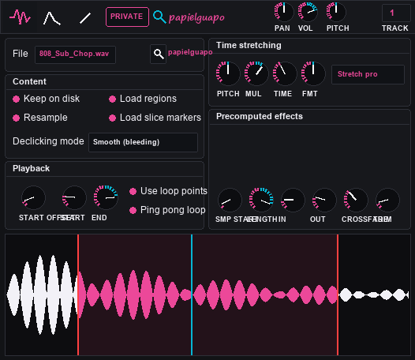

# FL Sampler - PAPIELGUAPO


Clon 1:1 de ingeniería inversa del **Sampler de FL Studio 2026** en formato **VST3 & Standalone (JUCE 8 / C++17)** para usar en **Ableton Live, Reaper, FL Studio, Cubase, Logic** o cualquier DAW.

Desarrollado por **PAPIELGUAPO** (`COMPANY_NAME: "PAPIELGUAPO"`, `ManufacturerCode: Papi`), incluye la firma vectorial `papielguapo` junto a la lupa y **4 skins intercambiables en tiempo real**:
1. **`SKIN: FL`** — Tema original FL Studio 2026 (`#2f353d` + verde neón `#67ff86` y naranja `#ff9e2c`).
2. **`SKIN: LIVE`** — Tema plano Ableton Live 12 (`#2b2b2b` + diales macro dorados `#ffb000` y cian `#06b6d4`).
3. **`PRIVATE`** — Tema exclusivo GrowthTune (`#121316` + anillos radiales neón rosa `#ec4899`, violeta `#a855f7` y cian `#06b6d4`).
4. **`SKIN: BLACK`** — Tema Stealth Puro Negro (`#050506` + paneles `#0b0b0e` + visor `#020203` + arcos monocromáticos blanco/platino).



---

## Características Principales (27 Mejoras 1:1 + Cross-Instance Choke Bus)

### 1. Pestaña Sample Settings (`SMP`)
- **Carga y Gestión de Samples**: Drag & Drop directo de `.wav / .aiff / .flac / .mp3 / .ogg`, navegador nativo (icono de carpeta), historial con navegación `< / >`, clic derecho en `File` para menú de **Recent Files**, y botón **Lupa** para abrir el archivo en el Explorador de Windows.
- **Detección Automática en Carga**:
  - Lectura de metadatos RIFF (`smpl` root note & loop points, `acid` BPM, `cue ` markers).
  - Detección automática de tono fundamental (**YIN Pitch Detector**) para muestras sin metadatos.
  - Detección automática de transientes (**Load Slice Markers**) con disparo por nota MIDI desde `C4` cuando `LOAD SLICES` está activo.
- **6 Modos de Declicking**: `Out only`, `Transient (no bleeding)`, `Transient (bleeding)`, `Generic (bleeding)`, `Smooth (bleeding)`, `Crossfade`.
- **Time Stretching + Formant Shift (`FMT`)**: Modos `Resample`, `e3 Generic`, `e3 Mono`, `Slice stretch`, `Slice map`, `Stretch` y `Stretch pro` (con preservación y desplazamiento de formantes `-12..+12 st`).
- **Precomputed Effects (12 Procesadores No Destructivos)**:
  - `Reverse`, `Swap Stereo`, `Remove DC`, `Normalize`
  - `Boost` + `Clip` (waveshaper estilo FL)
  - `Eq` (1kHz tilt), `RM Mix` + `RM Freq` (Ring Modulator), `Cutoff` + `Reso` (LPF precalculado), `Reverb` (`Freeverb` con cola extendida), `Stereo Delay`, `Pogo` (curva parabólica de pitch).
- **Visor Interactivo de Onda (`WAVScopeComponent`)**:
  - Zoom con rueda del ratón centrado en el cursor y paneo con botón central o clic derecho.
  - Banderas rojas arrastrables de `LOOP START` / `LOOP END` con **Zero-Crossing Snap** (desactivable manteniendo `Alt`).
  - Clic sobre la onda para **Audio Scrub / Preview** inmediato; `Alt + Arrastrar` o `Ctrl + Arrastrar` para **exportar el sample procesado (WAV Drag-Out)** directamente a la línea de tiempo de tu DAW.
  - Conmutadores `STEREO` (vista dual L/R) y `SPECTRUM` (espectrograma de calor).

### 2. Pestaña Envelope / Instrument Settings (`INS`)
- **Bancos Independientes de 5 Destinos (`Pan`, `Volume`, `Mod X`, `Mod Y`, `Pitch`)**:
  - Envolvente **AHDSR** de 6 etapas (`Delay`, `Attack`, `Hold`, `Decay`, `Sustain`, `Release`) + curvatura de tensión (`Attack/Decay/Release Tension`) y **nodos arrastrables directamente con el ratón** sobre la gráfica.
  - **LFO** por destino (`Delay`, `Attack`, `Amount`, `Speed`, formas `Sine / Triangle / Pulse`, modo `SYNC` al BPM del DAW y fase global).
  - Cursores de reproducción en tiempo real sobre las gráficas AHDSR y LFO.
- **Filtro Multimodo SVF de 6 Modos**: `Fast LP`, `LP`, `BP`, `HP`, `BS (Notch)`, `LPx2 (24 dB/oct Twin Peak)`.

### 3. Pestaña Miscellaneous Functions (`MISC`)
- **Levels Adjustments**: `Pan`, `Vol`, `Mod X`, `Mod Y`, `Pitch` + **Polyphonic Voice Unison / Fat Mode** (voces múltiples con detune y apertura estéreo).
- **Polyphony & Cross-Instance Cut Group Bus (`1..16`)**:
  - Polifonía máxima configurable (`MAX`), `PORTA` y `MONO` (glide/legato con curva exponencial), y **`CUT / BY` compartido en memoria estática entre todas las instancias abiertas del plugin** (ideal para que el Closed Hat corte al Open Hat en pistas distintas de Ableton Live).
- **Time / Gate / Swing**: Gate por nota y cuantización de `SWING` sincronizada al host.
- **Arpeggiator + Modo Chord**: Modos `Off / Up / Down / Up-Down / Sticky / Random`, `TIME`, `GATE`, `RANGE (1..4 oct)`, `REPEAT` y selector **`CHORD`** (`Major, Minor, Maj7, Min7, Sus2, Sus4, Fifth`).
- **Echo Delay / Fat Mode**: `FEED`, `PAN`, `MODX`, `MODY`, `PITCH`, `TIME`, `ECHOS (1..16)` y `PING PONG`.
- **Teclado Mini-Piano de 3 Octavas (C3..B5)**:
  - Preescucha con velocidad según la altura del clic, clic derecho para cambiar la **Root Key** (nota azul), y barra superior amarilla arrastrable para limitar el **Key Region (`keyLow..keyHigh`)**.

---

## Compilación (Windows / CMake + Visual Studio 2022)

```powershell
cmake -B build -G "Visual Studio 17 2022" -A x64
cmake --build build --config Release
```

Los binarios compilados se generan en:
- `build/FLSampler_artefacts/Release/VST3/FL Sampler.vst3`
- `build/FLSampler_artefacts/Release/Standalone/FL Sampler.exe`
