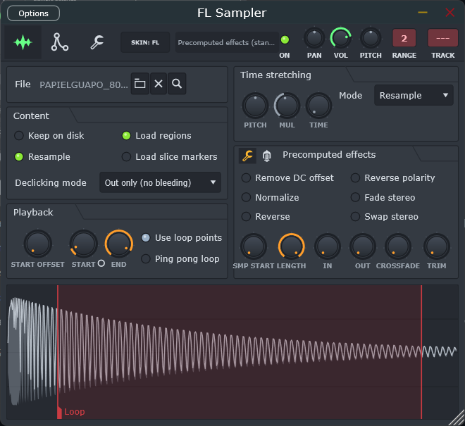
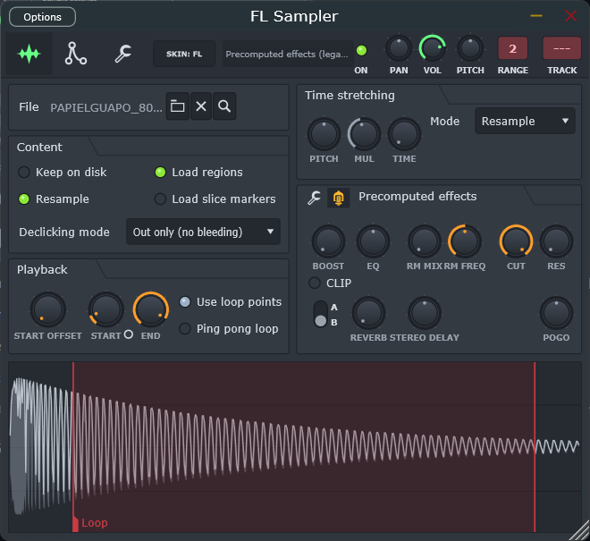
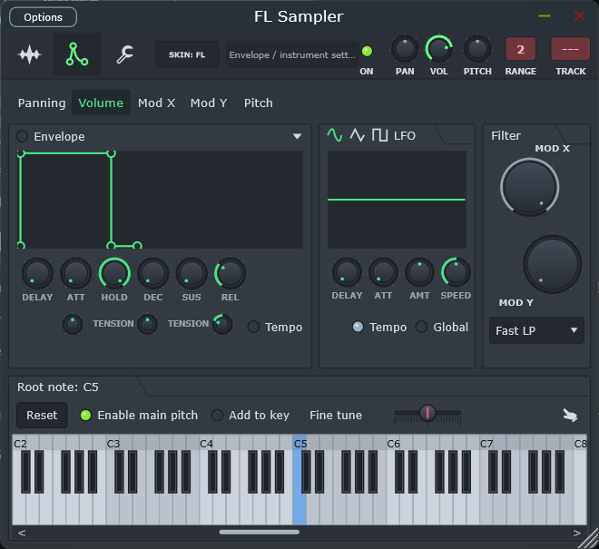
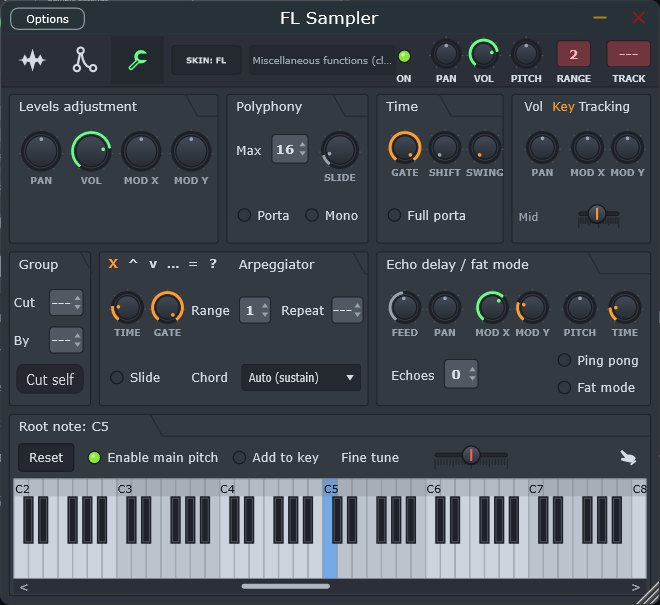
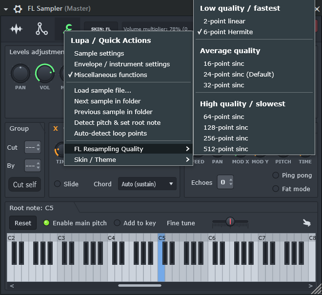
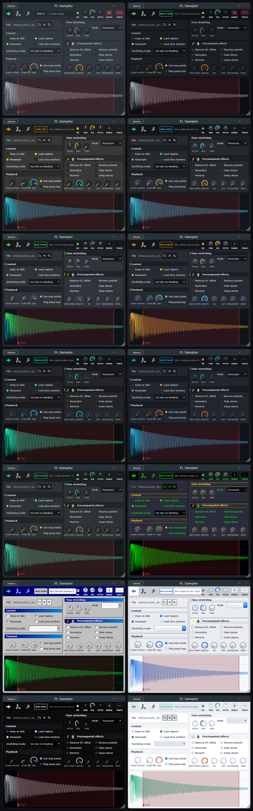

# FL Sampler - PAPIELGUAPO

> **Clon 1:1 del Sampler de FL Studio 2026** en formato **VST3 & Standalone** (Windows x64), desarrollado en **C++17 / JUCE 8** por **PAPIELGUAPO**.
> Incluye **14 Skins intercambiables en tiempo real**, motor de **FL Resampling Quality de 9 modos (hasta 512-Point Polyphase Sinc con SIMD)**, **Time Stretching multi-modo (10 algoritmos)**, **Precomputed Effects (Standard Wrench + Legacy Bulb)**, **5 destinos AHDSR + LFO + Filtro SVF Multimodo**, **Arpeggiator + Echo Delay / Fat Mode** y **Global Cross-Instance Cut Group Bus (128 instancias con auto-asignación inteligente de `Cut self`)**.

<p align="center">
  
</p>

---

## 📸 Vista Completa de las 3 Pestañas y Menú Rápido (Lupa)

### 1. Pestaña 1 — `Sample settings` (Standard Wrench & Legacy Bulb Precomputed Effects)
| Standard Precomputed Effects (Wrench 🔧) | Legacy Precomputed Effects (Bulb 💡) |
| :---: | :---: |
|  |  |

### 2. Pestaña 2 (`Envelope / instrument settings`) y Pestaña 3 (`Miscellaneous functions`)
| Pestaña 2: AHDSR + LFO + SVF Filter + Teclado C2..C8 | Pestaña 3: Levels, Polyphony, Cut Group, Arp & Echo Delay |
| :---: | :---: |
|  |  |

### 3. Menú Rápido Lupa (`Quick Actions`) y Selector `FL Resampling Quality` (hasta 512-Point Sinc)
<p align="center">
  
</p>

---

## 🎨 14 Skins / Temas Intercambiables en Tiempo Real (`SKIN: ...`)

Haz **clic izquierdo** en el botón **`SKIN: ...`** de la barra superior para rotar instantáneamente entre los **14 temas incluidos**, o haz **clic derecho** sobre el botón `SKIN` (o desde el menú de la **Lupa / Quick Actions**) para elegir cualquier skin directamente desde el menú desplegable:

| # | Etiqueta UI | Skin / Tema Inspirado en | Estilo Visual |
| :-: | :--- | :--- | :--- |
| **1** | `SKIN: FL` | **FL Studio 2026 (Default)** | Gris pizarra clásico de FL Studio 2026 (`#31373F`), anillos verde neón y naranja |
| **2** | `SKIN: FL DARK` | **FL Studio 2026 Dark Theme** | Carbón profundo (`#1B1E24`) con contraste reforzado y acentos neón |
| **3** | `SKIN: LIVE` | **Ableton Live 12** | Dispositivo plano estilo rack de Ableton Live 12 con acentos ámbar/amarillo y cian |
| **4** | `SKIN: LOGIC` | **Apple Logic Pro X (Quick Sampler)** | Chasis oscuro metálico con acentos azul celeste (`#26D6FF`) y ámbar |
| **5** | `SKIN: PTOOLS` | **Avid Pro Tools (Insert Rack)** | Estética de rack Pro Tools con LEDs verde fósforo (`#52FF52`) y forma de onda turquesa/verde |
| **6** | `SKIN: SEQUOIA` | **MAGIX Sequoia Mastering Suite** | Suite de mastering alemana con acentos ámbar/dorado (`#FFA019`) |
| **7** | `SKIN: AUDITION` | **Adobe Audition Spectral / Waveform** | Interfaz oscura Adobe Spectrum con forma de onda verde menta/turquesa (`#00F5B8`) |
| **8** | `SKIN: CUBASE` | **Steinberg Cubase 14 (Sampler Track)** | Diseño moderno de Cubase 14 con acentos azul eléctrico (`#00B7FF`) |
| **9** | `SKIN: REAPER` | **Cockos REAPER 7 Default TCP** | Paleta técnica gris-verdosa de REAPER 7 con acentos esmeralda (`#35D0A3`) |
| **10** | `SKIN: WINAMP` | **Nullsoft Winamp Classic 2.x** | Chasis biselado metálico clásico de los 90s con cabeceras bronce/oro y LEDs verde matriz |
| **11** | `SKIN: WIN98` | **Microsoft Windows 98 Classic** | Cuadros de diálogo 3D biselados grises (`#C0C0C0`) con barras de título azul marino degradado |
| **12** | `SKIN: MACOSX` | **Apple Mac OS X Aqua (10.0–10.4)** | Tarjetas redondeadas con rayas horizontales *Aqua pinstripes* y botones cristalinos azules |
| **13** | `SKIN: BLACK` | **BLACK Stealth (Pure Pitch-Black)** | Modo OLED `#09090B` ultra oscuro con contornos blancos de alto contraste |
| **14** | `SKIN: WHITE` | **WHITE Studio (Pure White)** | Estudio minimalista blanco puro con forma de onda esmeralda e indicadores de alta legibilidad |

### Vista Previa Rápida (4 Skins Destacadas: FL Dark, Ableton Live 12, Logic Pro X, Windows 98)
<p align="center">
  
</p>

### Galería Completa de las 14 Skins Incluidas
<p align="center">
  
</p>

---

## ✨ Novedades y Características Principales (Última Versión)

### 🔬 1. Motor de Interpolación `FL Resampling Quality` 1:1 (Hasta 512-Point Sinc con SIMD)
Implementado en `PolyphaseSincLUT` (`Source/DSP/SamplerEngine.h`) y seleccionable tanto para la reproducción en tiempo real como para los efectos precomputados (por ejemplo *Pogo* y *Resample*):
- **Low quality / fastest**:
  - `2-point linear`: Interpolación lineal ultrarrápida con cero sobrecarga de CPU.
  - `6-point Hermite`: Polinomio cúbico Hermite de 6 puntos para transitorios limpios.
- **Average quality**:
  - `16-point sinc`, `24-point sinc (Default)`, `32-point sinc`.
- **High quality / slowest (Mastering Grade)**:
  - `64-point sinc`, `128-point sinc`, `256-point sinc`, `512-point sinc`.
- **Arquitectura DSP de la tabla polifásica (`PolyphaseSincLUT`)**:
  - **512 fases fraccionarias** con interpolación lineal entre sub-fases adyacentes.
  - **16 tablas dinámicas de corte anti-aliasing por octava** (`cutoff` adaptativo cuando `pitchRatio > 1.0`) para eliminar *aliasing* al transponer hacia arriba sin apagar los agudos al tocar hacia abajo.
  - Ventana **4-term Blackman-Harris** con rechazo de lóbulos laterales de **-92 dB** y ganancia unitaria normalizada por fase.
  - Aceleración vectorial **SSE SIMD (`_mm_mul_ps` / `_mm_add_ps`)** con memoria alineada a 32 bytes.

---

### 🌊 2. Pestaña 1: `Sample settings` (Contenido, Loop, Time Stretch y Precomputed Effects)
- **Barra `File`**:
  - Carga de archivos `.wav`, `.flac`, `.mp3`, `.ogg`, `.aiff` mediante el botón de carpeta, **Drag & Drop directo** desde tu DAW / Explorador de Windows, o clic derecho para abrir la lista de **Recent Sample Files**.
  - Navegación instantánea por la carpeta actual (**Siguiente / Anterior sample** con clic izquierdo/derecho en el icono de la lupa de archivo o desde el menú rápido).
  - **Drag-Out Export a DAW**: Arrastra directamente desde el visor de forma de onda (`WAVScopeComponent`) hacia la playlist o pista de tu DAW para exportar el sample ya procesado en 24-bit WAV.
- **Panel `Content`**:
  - `Keep on disk`, `Resample`, `Load regions`, `Load slice markers`.
  - **6 Modos de Declicking (`Declicking mode`)** idénticos a FL Studio:
    1. `Out only (no bleeding)` *(por defecto)*
    2. `Transient (no bleeding)`
    3. `Transient (bleeding)`
    4. `Generic (bleeding)`
    5. `Smooth (bleeding)`
    6. `Crossfade (bleeding)`
- **Panel `Playback` y Región de Loop Interactiva**:
  - Knobs `START OFFSET`, `START` (Loop Start) y `END` (Loop End) con **auto-activación inteligente de `Use loop points`** en cuanto mueves `START` o `END`.
  - Modo `Ping pong loop` bidireccional.
  - Visor inferior con sombreado rojo carmesí `Loop`, banderas arrastrables directamente con el ratón sobre la onda, ajuste automático a cruces por cero (**Snap to Zero-Crossing**), zoom/scroll horizontal en la barra inferior y vista espectral opcional.
- **Panel `Time stretching` (10 Modos)**:
  - Knobs `PITCH` (±1200 cents), `MUL` (multiplicador 25%..400%) y `TIME` (sincronizable a tempo / divisiones musicales).
  - **Modos incluidos**: `Resample`, `e3 generic`, `e3 mono`, `Slice stretch`, `Slice map`, `Stretch`, `Stretch pro` (activa automáticamente el slider bipolar rojo **`FMT` / Formant Shift** de ±12 semitonos), `e2 generic`, `e2 transient`, `e2 mono`, `e2 speech`.
- **Panel `Precomputed effects` (Doble Sub-Pestaña)**:
  - **Sub-pestaña Wrench 🔧 (Standard)**:
    - Botones: `Remove DC offset`, `Reverse polarity`, `Normalize`, `Fade stereo`, `Reverse`, `Swap stereo`.
    - Knobs: `SMP START`, `LENGTH`, `IN` (Fade In), `OUT` (Fade Out), `CROSSFADE` (crea un loop crossfade continuo con previsualización en tiempo real en el visor de onda) y `TRIM` (recorte logarítmico inteligente de cola de silencio de `-90 dB` a `-14 dB` con ventana deslizante de picos).
  - **Sub-pestaña Bulb 💡 (Legacy Precomputed Effects)**:
    - `BOOST` + botón `Clip`, `EQ` (tilt/presence), `RM MIX` + `RM FREQ` (Ring Modulator), `CUT` + `RES` (filtro precomputado), `REVERB` con selector de sala **A / B**, `STEREO DELAY` y `POGO` (curva de *pitch-warp* no lineal renderizada con la calidad Sinc seleccionada).

---

### 📈 3. Pestaña 2: `Envelope / instrument settings` (5 Destinos + Presets `.flenv`)
- **5 Destinos Independientes**: `Panning` (gráfico LFO), `Volume`, `Mod X` (Cutoff), `Mod Y` (Resonance) y `Pitch`.
- **Envolvente Gráfica Interactiva `AHDSR` de 6 Etapas**:
  - Knobs de `DELAY`, `ATT`, `HOLD`, `DEC`, `SUS`, `REL` y `AMT` (Amount bipolar en Mod X / Mod Y / Pitch).
  - Knobs de curvatura/tensión dedicados (`ATT`, `DEC`, `REL` tension) y modo `Tempo` sync.
  - **Nodos arrastrables directamente en la gráfica** + **Menú de Presets de Envolvente** (botón de flecha o clic derecho en la gráfica):
    - Presets incluidos: *808 / Square Hold (FL Default)*, *Short Pluck*, *Punchy Drum / Perc*, *Full Sustain Gate*, *Soft Pad / Swell*, *Filter / Pitch Pluck (+Amount)*, *Reset / Flat*, además de guardar y cargar tus propios presets **`.flenv`**.
- **Sección `LFO` por Destino**:
  - 3 formas de onda (`Sine`, `Triangle`, `Pulse`), knobs `DEL`, `ATT`, `AMT` (bipolar) y `SPEED` (con nombres de divisiones musicales cuando `Tempo` está activo) + fase `Global`.
- **Sección `Filter` Multimodo SVF**:
  - Knobs `MOD X` (Cutoff) y `MOD Y` (Resonance) con **6 respuestas de filtro**: *Fast LP*, *LP*, *BP*, *BS*, *HP* y *SVF LPx2* (doble etapa en cascada de 24 dB/oct).

---

### 🛠️ 4. Pestaña 3: `Miscellaneous functions` y Teclado `C2..C8`
- **`Levels adjustment`**: Multiplicadores finales de `PAN`, `VOL`, `MOD X` y `MOD Y`.
- **`Polyphony`**: Límite de voces (`Max 1..32`), tiempo de portamento (`SLIDE`) con curva exponencial estilo FL Studio, botones `Porta` y `Mono`.
- **`Time`**: `GATE`, `SHIFT` (retardo de nota sub-bloque sample-accurate), `SWING` y `Full porta`.
- **`Vol / Key Tracking`**: Seguimiento por velocidad o nota MIDI con nota central ajustable (`Mid`) hacia `PAN`, `MOD X` y `MOD Y`.
- **`Group` (`Cut` / `By` / `Cut self`) con Bus Global Inter-Instancia**:
  - Hasta **128 instancias simultáneas** conectadas mediante `GlobalChokeBus` lock-free en memoria compartida del proceso.
  - Al pulsar **`Cut self`**, el plugin busca automáticamente el siguiente grupo libre (`1..99`) que no esté siendo usado por ninguna otra instancia abierta en tu proyecto y asigna `Track = N`, `Cut = N` y `By = N` automáticamente (evitando que dos pistas con `Cut self` se corten entre sí por accidente, pero permitiendo cortar pistas distintas si les pones el mismo número manualmente).
- **`Arpeggiator`**:
  - 6 modos de dirección (`Off`, `Up`, `Down`, `Up-Down Bounce`, `Up-Down Sticky`, `Random`), `TIME`, `GATE`, `Range` (1..4 octavas), `Repeat`, `Slide` y selector `Chord` (*Auto (sustain)*, *None*, *Major*, *Minor*, *7th*, *Sus2*, *Sus4*).
- **`Echo delay / fat mode`**:
  - Generador de ecos MIDI/voz y modo **Unison `Fat mode`** con controles `FEED`, `PAN`, `MOD X`, `MOD Y`, `PITCH`, `TIME`, contador `Echoes` (`0..16`) y `Ping pong`.
- **Teclado Inferior `Root note` (`C2..C8` + Modo Zoom Táctil)**:
  - **Clic izquierdo** en cualquier tecla para preescuchar la nota; **clic derecho** para asignar la `Root note` (marcada en azul/naranja estilo FL).
  - Controles `Reset`, `Enable main pitch`, `Add to key`, slider bipolar `Fine tune` y botón **Mano / Zoom (`keybHandBtn`)** a la derecha para alternar entre el teclado completo de **6 octavas (`C2..C8`)** y la vista ampliada táctil (`B3..D6`).

---

## 📦 Instalación Rápida (Binarios Precompilados Incluidos)

En la raíz del repositorio y en la sección [**Releases**](https://github.com/papielguapo/FLSampler/releases) tienes listos para usar:

1. **Formato Plugin VST3 (`FL Sampler.vst3`)**:
   - Copia la carpeta/bundle `FL Sampler.vst3` en la ruta de plugins VST3 de tu sistema:
     ```text
     C:\Program Files\Common Files\VST3\FL Sampler.vst3
     ```
   - Reescanea plugins en **FL Studio 2026**, **Ableton Live 12**, **Logic / Reaper / Cubase / Pro Tools (vía wrapper) / Studio One** y ábrelo como instrumento.
2. **Formato Aplicación Independiente (`FL Sampler.exe`)**:
   - Ejecuta directamente `FL Sampler.exe` sin necesidad de abrir ningún DAW.

---

## 🛠️ Compilación desde el Código Fuente (CMake + Visual Studio 2022)

### Requisitos
- **Windows 10 / 11 (x64)**
- **Visual Studio 2022** con carga de trabajo *Desarrollo para el escritorio con C++* (MSVC v143)
- **CMake 3.22+** (incluye descarga automática de **JUCE 8.0.4** mediante `FetchContent` si no está en `C:/JUCE`)

### Comandos de Compilación
```powershell
cmake -B build -G "Visual Studio 17 2022" -A x64
cmake --build build --config Release --parallel
```

Los artefactos compilados se generan automáticamente en:
- `build/FLSampler_artefacts/Release/VST3/FL Sampler.vst3`
- `build/FLSampler_artefacts/Release/Standalone/FL Sampler.exe`

---

## 👤 Autor

Desarrollado por **PAPIELGUAPO** (`@papielguapo`).
